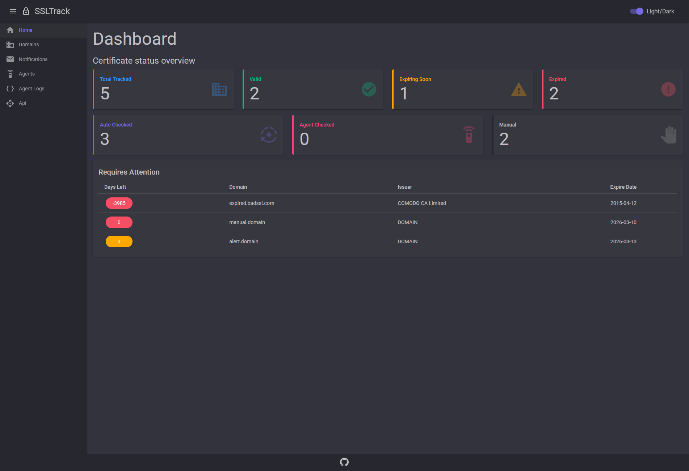
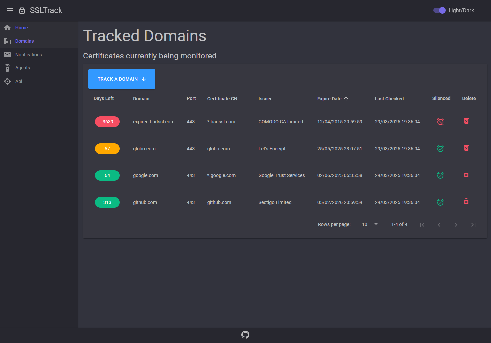

# SSLTrack

Monitor SSL/TLS certificate expiration across multiple domains and receive email alerts before they expire. SSLTrack uses a distributed architecture with remote agents that can check certificates from different network locations.





---

## Features

- **Certificate monitoring** — track expiry dates, issuer, and common name for any domain
- **Distributed agents** — deploy lightweight agents in different networks to check certificates from multiple vantage points
- **Email alerts** — automated SMTP notifications when certificates approach expiration (configurable threshold)
- **Blazor web UI** — manage domains, agents, and settings from a browser
- **Local and organization sign-in** — password-based accounts or optional OpenID Connect (OIDC), with an administrator provisioned at first startup
- **Role-based access** — Admin users manage monitoring and configuration; ReadOnly users view monitoring and manage their own profile
- **User administration** — create users, enable or disable accounts, reset local passwords, and require a password change at next sign-in
- **Personal profiles** — edit display names, change local passwords, and choose a default avatar, Gravatar, or custom HTTPS picture
- **Agent service accounts** — manage dedicated credentials scoped to a single remote agent, with password rotation and account disabling
- **SMTP configuration UI** — save mail settings in the database, choose STARTTLS or TLS on connect, and send test notifications; stored SMTP passwords use ASP.NET Core Data Protection
- **REST API** — full API with Swagger/OpenAPI documentation
- **Background scheduling** — Hangfire-powered recurring jobs for checks, alerts, and log cleanup
- **Docker ready** — pre-built images on Docker Hub, Docker Compose included

---

## Quick Start (Docker Compose)

The fastest way to run SSLTrack with a bundled SMTP test server:

```bash
git clone https://github.com/zimbres/SSLTrack.git
cd SSLTrack

# For a LOCAL HTTP demo only; production requires HTTPS (see setup guide).
export SSLTRACK_ENVIRONMENT=Development
export SSLTRACK_ADMIN_EMAIL='your-admin@example.com'
# Set SSLTRACK_ADMIN_PASSWORD securely in your environment (12–128 characters).

# Edit the two config files before starting
# appsettings.ssltrack.json  — main app config
# appsettings.agent.json     — agent config

docker compose up -d
```

| Service | URL |
|---|---|
| SSLTrack web UI (local demo) | http://localhost:8080 |
| SMTP4Dev (test mail) | http://localhost:8025 |

---

After signing in, change the bootstrap password, create your agent and its service account, configure the worker credentials, and set SMTP on **SMTP configuration**. Production deployments must configure HTTPS and trusted proxy forwarding before use. See [setup instructions](docs/authentication-setup.md).

## Pre-built Container

```bash
docker pull zimbres/ssltrack
```

> Docker Hub: https://hub.docker.com/r/zimbres/ssltrack

---

## Manual Installation

A pre-compiled binary is available for Windows and Linux. Requires the ASP.NET Core Runtime 10.x.

- [Download .NET 10.0 Runtime](https://dotnet.microsoft.com/en-us/download/dotnet/10.0)
- Download the latest release from the [Releases page](../../releases)

```bash
# Linux (example)
./SSLTrack
```

---

## Authentication and configuration

SSLTrack requires sign-in for the website and REST API. Before first startup, provision an administrator with `Authentication__Bootstrap__Email` and `Authentication__Bootstrap__Password`. No default account is shipped. See [setup and upgrade instructions](docs/authentication-setup.md) for OIDC, roles, profiles, SMTP migration, and agent service accounts, and the [API authorization contract](docs/api/authentication.md).

### Accounts and access

- **Users** (Admin): create local or OIDC users, assign Admin or ReadOnly access, reset local passwords, and disable or restore accounts. Select **Show disabled users** to find disabled accounts. The last enabled administrator cannot be disabled or demoted.
- **My profile**: update your display name and picture. Local users can also change their password. Email remains the permanent sign-in identifier.
- **Service accounts** (Admin): create credentials for an existing remote agent, rotate passwords, disable accounts, or delete them. These accounts have no website access.

Local and service-account passwords must contain 12–128 characters. The bootstrap administrator must change their password on first sign-in. OIDC users must be created by an administrator before organization sign-in; SSLTrack requires a verified email and links the provider identity on first login. See the [OIDC setup and Keycloak example](docs/authentication-setup.md#oidc).

### SMTP and upgrade behavior

Open **SMTP configuration** as an Admin to configure the sender, recipients, BCC, server, port, TLS mode, and optional credentials. Separate multiple recipient addresses with semicolons. Save changes before selecting **Send test notification**; background alerts use the saved settings on their next delivery.

Existing `MailProperties` configuration is imported once when no SMTP database settings exist. After import, manage SMTP in the UI and remove legacy credentials from configuration. Leaving the password blank preserves it; **Clear saved SMTP password** removes it. Back up the SQLite database together with its persisted Data Protection keys before upgrading. See the [setup and upgrade instructions](docs/authentication-setup.md) for migration and deployment details.

## Configuration

### Main Application (`appsettings.ssltrack.json`)

```json
{
  "ConnectionStrings": {
    "Data": "Data Source=./data/data.db"
  },
  "Configurations": {
    "DaysToExpiration": 30,
    "AlertsEnabled": true,
    "UpdateCron": "*/5 * * * *",
    "AlertCron": "*/5 * * * *",
    "ClearLogsCron": "*/5 * * * *"
  }
}
```

| Key | Description |
|---|---|
| `DaysToExpiration` | Days before expiry to start alerting |
| `AlertsEnabled` | Enable or disable email alerts |
| `UpdateCron` | Cron schedule for certificate checks |
| `AlertCron` | Cron schedule for sending alert emails |
| `ClearLogsCron` | Cron schedule for clearing old logs |

### Agent (`appsettings.agent.json`)

```json
{
  "Configurations": {
    "Delay": 5,
    "SSLTrackApiAddress": "https://ssltrack.example.com",
    "AgentId": 2,
    "AuthType": "Basic",
    "GrantType": "client_credentials",
    "ClientId": "ID",
    "Username": "agent-2@example.com",
    "Password": "",
    "AuthUrl": "https://auth/application/o/token/"
  },
  "HttpClientConfiguration": {
    "UseProxy": false,
    "IgnoreSsl": false
  }
}
```

| Key | Description |
|---|---|
| `Delay` | Seconds between certificate check cycles |
| `SSLTrackApiAddress` | URL of the main SSLTrack server |
| `AgentId` | Unique numeric ID for this agent (must match an agent record in the UI) |
| `AuthType` | Use `Basic` with an agent service account; Token/OAuth2 remains for external setups |
| `IgnoreSsl` | Skip TLS validation for the connection to the main server |

---

## Architecture

```
┌──────────────────────────────┐
│       SSLTrack Web App       │  Blazor UI + REST API + Hangfire scheduler
│ SQLite · EF Core · MudBlazor │
└──────────────┬───────────────┘
               │ HTTP (REST)
     ┌─────────┴──────────┐
     │                    │
┌────┴─────┐         ┌────┴─────┐
│  Agent 1 │   ...   │  Agent N │  .NET Worker services
│ (local)  │         │ (remote) │  Poll domains, check certs, report back
└──────────┘         └──────────┘
```

- The **main application** stores domains and agents in SQLite, runs scheduled jobs, and serves the UI and API.
- Each **agent** is a lightweight background worker. It fetches its assigned domains from the main app, connects to each domain to retrieve the SSL certificate, and posts the results back.
- Agents authenticate to SSLTrack with **HTTP Basic** service accounts scoped to one agent. Create and rotate them in the Admin-only Service accounts page. HTTPS is required outside local development. Existing external Token/OAuth2 client support remains available on the agent.

---

## API Reference

Interactive documentation is available at `/api/swagger` after human sign-in. Monitoring API reads require Admin or ReadOnly; writes require Admin, except scoped agent reports/logs/heartbeats. See [API permissions](docs/api/authentication.md).

| Method | Endpoint | Description |
|---|---|---|
| `GET` | `/api/domains` | List all domains |
| `GET` | `/api/domains/agents/{agentId}` | Domains assigned to an agent |
| `POST` | `/api/domains` | Add a domain |
| `PUT` | `/api/domains/{domainName}` | Update domain certificate data |
| `DELETE` | `/api/domains/{domainId}` | Remove a domain (Admin) |
| `GET` | `/api/health` | Health check |
| `HEAD` | `/api/ping/{agentId}` | Agent heartbeat |
| `GET` | `/api/logs` | Retrieve logs |
| `POST` | `/api/logs/clear` | Clear all logs |

Hangfire dashboard: `/hangfire`

---

## Warning — Background Jobs

> Background jobs (certificate checks and email alerts) will not start automatically when the application restarts unless there is activity on the web UI or API.

To keep jobs running reliably, configure an external uptime monitor to call the health endpoint periodically:

```
GET https://your-server/api/health
```

Or follow the [Hangfire production deployment guide](https://docs.hangfire.io/en/latest/deployment-to-production/making-aspnet-app-always-running.html).

---

## Development

### Requirements

- [.NET 10 SDK](https://dotnet.microsoft.com/en-us/download/dotnet/10.0)
- Docker (optional, for Docker Compose)

### Run locally

```bash
# Main application (http://localhost:5096)
cd src/SSLTrack
dotnet run

# Agent — in a separate terminal
cd src/SSLTrackAgent
dotnet run
```

### Run with .NET Aspire

```bash
cd src/SSLTrack.AppHost
dotnet run
```

---

## License

[GNU Affero General Public License v3](LICENSE)
